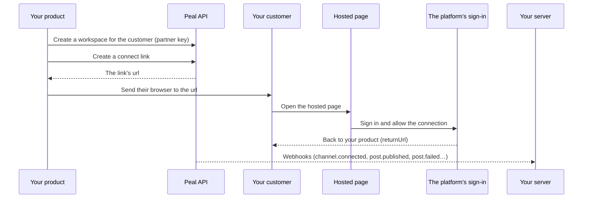

A product of yours can publish to social platforms for its own customers through Peal, without any of them having a Peal account or seeing Peal's app.

| Piece                            | What it is                                                     |
| -------------------------------- | -------------------------------------------------------------- |
| [Partner account](#account)      | What you hold                                                  |
| [Workspace](#workspaces)         | One for each of your customers, owned by the partner account   |
| Partner key                      | What your backend acts in those workspaces with                |
| [Hosted page](#connect)          | Where you send your customers to connect their social accounts |
| [Webhooks](/developers/webhooks) | How Peal tells your server what happens                        |



A workspace is the unit Peal isolates: its channels, posts, media, analytics and webhooks belong to it alone, and deleting it erases all of them. Giving each customer its own keeps one customer's accounts and posts out of every other's reach, by construction rather than by a filter in your code.

## Get a partner account [#account]

A partner account belongs to a workspace of yours, its home workspace: the one you signed up with, where your team's members are. The owners and admins of that workspace run the account.

- On Peal Cloud, partner accounts are opened by Peal's team: write to us with what you build.
- On a self-hosted Peal, staff grant one from the [staff console](/self-hosting/staff#partners), on a workspace's page. Setting [`PEAL_PARTNER_SELF_SERVICE`](/self-hosting/environment-variables#sign-in) to `true` lets the owners and admins of any workspace open one themselves, under **Settings**, then **Partner**.

Then set it up under **Settings**, then **Partner**, in the web app:

<Steps>
  <Step title="Name, logo and accent colour">
    What your customers read on the hosted pages: a name of 80 characters at
    most, the HTTPS address of a logo, which their browser loads from your
    server, and an accent colour, drawn as a line along the top of the page's
    card, above your logo.
  </Step>
  <Step title="Return origins">
    The origins a hosted page may send your customers back to, such as
    `https://app.example.com`: scheme, host and port, with nothing after, 20 at
    most. Plain `http://` is taken for `localhost` only, to try the flow in
    development. A hosted page returns to an address on one of these origins,
    exactly, and nowhere else.
  </Step>
  <Step title="A partner key">
    Its name, what it may do with your workspaces and what it may do inside
    each. The key is shown once: put it in your backend's secrets.
  </Step>
</Steps>

### Accent colour [#accent]

The accent colour is six hexadecimal digits, such as `#415EEE` (`accentColor` in `PATCH /api/workspaces/{workspaceId}/partner`, `null` to remove it). Peal's pages are light, and the colour is drawn as a line that must be seen, so it needs a contrast of at least 3:1 with white and with the page's background (`#FAFAF9`), the bar WCAG sets for such a line. A lighter colour, or anything else than `#RRGGBB`, answers 422 `PartnerDetailsInvalid` with `field` `accentColor`, and nothing is saved. Buttons and text keep Peal's colours, so they stay readable whatever colour you choose.

### Partner keys [#keys]

A partner key starts with `peal_partner_`, and is sent as `Authorization: Bearer peal_partner_…`. Only a signed-in owner or admin creates one, in the web app: no key and no application creates keys. Revoke one there, or with `DELETE /api/workspaces/{workspaceId}/partner/keys/{partnerKeyId}`; it stops working at once.

| A key's scope       | What it allows                                        |
| ------------------- | ----------------------------------------------------- |
| `workspaces:read`   | List and read the workspaces the partner account owns |
| `workspaces:write`  | Create them, rename them, change their external id    |
| `workspaces:delete` | Delete one, with everything in it                     |

Inside each workspace it owns, a partner key holds the [permissions](/guides/posts#roles) you ticked, among those a product needs for its customers:

- `channel:*`, `media:*`, `post:*`, `analytics:read`, `assistant:use`, `webhook:*` and `billing:read`;
- `engagement:read` and `engagement:reply`: the [comments](/guides/engage/inbox) under a customer's posts, and answering them in public as its account. Other people wrote those comments, so give a key these only if your product shows or answers them;
- never the [direct messages](/guides/engage/inbox#direct-messages)' permissions (`engagement:readMessages`, `engagement:message`): only an owner of a workspace, in person, lets an application into them, and a customer's workspace has none;
- `assistant:configure`, to set each customer's own [image provider](/guides/workspace#image-provider): `PUT /api/workspaces/{workspaceId}/assistant/image-provider`, with the customer's key, one workspace at a time;
- `activity:read`, which reads the workspace's [activity log](/guides/workspace#activity): what your key asked to change there, and the accounts connected through connect links.

A partner key never holds what belongs to people: members, invitations, API keys, billing changes.

### What a partner key reaches [#isolation]

| With a partner key                                         | Answer                      |
| ---------------------------------------------------------- | --------------------------- |
| A workspace its partner account owns                       | What its permissions allow  |
| A workspace another partner owns                           | 404, as if it did not exist |
| Any other workspace, your home workspace included          | 404                         |
| `/api/me`, members, invitations, API keys of any workspace | 403                         |

The other way round, an API key of a workspace, a member's session or an OAuth token never calls `/api/partner`: 403.

[Two-step verification](/guides/workspace#require-two-step) concerns people. Partner keys and your customers' workspaces, which have no member, are not affected by it, while your home workspace's owners may require it of its members like any workspace's.

## Create a workspace for each customer [#workspaces]

When a customer signs up with you, create their workspace, with your own id for them as its `externalId`. Peal keeps it, finds the workspace by it, and writes it in every [webhook](/developers/embedding/operate#webhooks) of that workspace, so you keep no table mapping your ids to Peal's.

<CodeGroup>

```bash curl
curl -X POST https://api.example.com/api/partner/workspaces \
  -H "Authorization: Bearer $PEAL_PARTNER_KEY" \
  -H "Content-Type: application/json" \
  -H "Idempotency-Key: signup-cus_42" \
  -d '{"name": "Boulangerie Martin", "externalId": "cus_42"}'
```

```typescript TypeScript
import { PealClient } from "peal-sdk";

const peal = new PealClient({
  token: process.env.PEAL_PARTNER_KEY,
  baseUrl: "https://api.example.com",
});

const workspace = await peal.partner.createWorkspace({
  name: "Boulangerie Martin",
  externalId: "cus_42",
  "idempotency-key": "signup-cus_42",
});
// workspace.id is what every other call takes as workspaceId
```

```python Python
import os
from peal import Peal

peal = Peal(token=os.environ["PEAL_PARTNER_KEY"], base_url="https://api.example.com")

workspace = peal.partner.create_workspace(
    name="Boulangerie Martin",
    external_id="cus_42",
    idempotency_key="signup-cus_42",
)
```

</CodeGroup>

A creation is safe to send again, two ways:

| By                | What happens                                                                                                                                                                                |
| ----------------- | ------------------------------------------------------------------------------------------------------------------------------------------------------------------------------------------- |
| `externalId`      | It is unique among your workspaces. A second workspace with the same one answers 409 `ExternalIdTaken`, whose `workspaceId` is the workspace that has it: a signup retried never makes two. |
| `Idempotency-Key` | Within 24 hours, the same key with the same body answers the workspace the first request made, and makes no other; the same key with another body answers 409 `IdempotencyKeyReused`.       |

| Request                                        | What it does                                                                                                                                |
| ---------------------------------------------- | ------------------------------------------------------------------------------------------------------------------------------------------- |
| `GET /api/partner`                             | The partner account, and what it holds: workspaces and channels, now and at the end of each of the last 35 days                             |
| `GET /api/partner/workspaces`                  | Your workspaces, newest first, each with its number of channels: `externalId` finds one exactly, `name` searches, `limit` and `before` page |
| `POST /api/partner/workspaces`                 | Creates one                                                                                                                                 |
| `GET /api/partner/workspaces/{workspaceId}`    | Reads one                                                                                                                                   |
| `PATCH /api/partner/workspaces/{workspaceId}`  | Changes its name or its external id (`null` removes it)                                                                                     |
| `DELETE /api/partner/workspaces/{workspaceId}` | Deletes it, with everything in it ([Offboard a customer](/developers/embedding/operate#offboard))                                           |

A list answers `total`, what the filters find in all, and `next`: pass it as `before` for the next page, as it is, until it is null. It is a position in the list, not a workspace's id. It stays good when the workspaces before it are offboarded, and anything else in `before` answers 400.

```typescript
const { workspaces } = await peal.partner.listWorkspaces({
  externalId: "cus_42",
});
```

A workspace you create has no members: nobody signs in to it, and only your keys act in it.

## Let a customer connect their accounts [#connect]

Your customer owns their social accounts, and only they can sign in to them. You create a connect link for one platform, send their browser to it, and they come back to your product once the account is connected. They never see a password field of yours, and Peal never sees their password either: the platform's own sign-in page asks for it.

<CodeGroup>

```typescript TypeScript
const { link, url } = await peal.connectLinks.create({
  workspaceId: workspace.id,
  platform: "linkedin",
  returnUrl: "https://app.example.com/settings/social",
  expiresInHours: 24,
  locale: "fr",
});
// Keep link.id with your customer; redirect their browser to url.
```

```python Python
created = peal.connect_links.create(
    workspace_id=workspace.id,
    platform="linkedin",
    return_url="https://app.example.com/settings/social",
    expires_in_hours=24,
    locale="fr",
)
# created.link.id, created.url
```

</CodeGroup>

| Field            | What it is                                                                                                                                                                                                                                                                                                                        |
| ---------------- | --------------------------------------------------------------------------------------------------------------------------------------------------------------------------------------------------------------------------------------------------------------------------------------------------------------------------------- |
| `platform`       | One of the platforms [the instance connects](/guides/channels#connect)                                                                                                                                                                                                                                                            |
| `returnUrl`      | Where the page sends them once done. Its origin must be one of your [return origins](#account), exactly: 422 `ReturnUrlNotAllowed` otherwise.                                                                                                                                                                                     |
| `expiresInHours` | How long the link works, from 1 to 720 (30 days): 168 (a week) unless given                                                                                                                                                                                                                                                       |
| `locale`         | `en` or `fr`: the language the page opens in. Left out, the visitor's own.                                                                                                                                                                                                                                                        |
| `channelId`      | Reconnect this channel instead of connecting a new account ([Reconnect](#reconnect))                                                                                                                                                                                                                                              |
| `connection`     | The way in, on the platforms that have several: for Instagram, `instagramLogin` or `facebookLogin` ([Instagram](/platforms/instagram#connect)); for LinkedIn, `linkedinProfile` (the member's profile) or `linkedinPage` (the company pages they manage) ([LinkedIn](/platforms/linkedin#connect)). Left out, the server's first. |

The answer's `url` is shown once: Peal keeps only a digest of the token it holds. Needs `channel:connect`.

### What your customer sees [#hosted-page]

<Steps>
  <Step title="Your name, logo and accent colour">
    With one sentence: you ask to connect their account of that platform, to
    publish there for them. For Mastodon the page asks for their server, for
    Bluesky their handle.
  </Step>
  <Step title="The platform's sign-in page">
    They sign in there and allow the connection.
  </Step>
  <Step title="A choice">
    When the sign-in reached several accounts (the Pages a Facebook user
    manages, the Instagram accounts linked to them, a Google account's YouTube
    channels), they tick those to connect.
  </Step>
  <Step title="Back to your returnUrl">
    The page sends them back to your product.
  </Step>
</Steps>

The page is in English or French, shows none of Peal's app, and says the connection is handled by Peal. It is kept out of search engines.

### When they come back [#return]

Peal adds two parameters to your `returnUrl`, over any of the same name:

| Parameter     | Value                                                                |
| ------------- | -------------------------------------------------------------------- |
| `peal_link`   | The link's id                                                        |
| `peal_status` | `connected`, `cancelled` (they chose to go back instead) or `failed` |

<Callout type="warning" title="Anyone can write those parameters">
  Treat them as a hint to look, never as proof: read the link with your key.
</Callout>

```typescript
const link = await peal.connectLinks.get({ workspaceId, linkId });

if (link.status === "completed") {
  // link.channelIds: the channels it connected
}
```

| A link's `status` | Meaning                                                                        |
| ----------------- | ------------------------------------------------------------------------------ |
| `pending`         | It waits to be used. `failure` says how its last sign-in ended, if one failed. |
| `completed`       | It connected the channels in `channelIds`, and opens nothing more              |
| `revoked`         | You took it back                                                               |
| `expired`         | Its time passed                                                                |

Do not wait on the browser alone: a customer may close the tab before coming back. Subscribe to [`channel.connected`](/developers/webhooks/events/channels#channel-connected), which Peal sends when the account is connected, with the workspace's `workspaceExternalId`.

`DELETE /api/workspaces/{workspaceId}/connect-links/{linkId}` revokes a link. `GET …/connect-links` lists a workspace's links, those waiting and those over in the last 30 days.

### Reconnect [#reconnect]

When a platform stops accepting a channel's authorization, Peal sends [`channel.reconnect_needed`](/developers/webhooks/events/channels#channel-reconnect-needed). Create a link with that channel's `channelId`. Its page names the account, and only a sign-in to that same account goes through, so the channel keeps its id, its posts and its analytics.

### What a link is, and is not [#link-security]

<Callout type="warning" title="A link is a credential">
  Whoever holds its address can connect an account of theirs to that workspace
  until it is used, revoked or expired. Send your customer's browser to it from
  a page they are signed in to, or over a channel you trust. Give it the
  shortest life that fits, and revoke those you no longer need.
</Callout>

- A link is used once, by a sign-in that connects an account. Opening it uses nothing, so a link preview does not spend it.
- It gives nothing else. It reads no post, no channel and no token, and reaches no other workspace.
- Only the browser that started the sign-in completes it. The platform's answer, replayed in another browser, connects nothing.
- It returns only where you said. A `returnUrl` on an origin you did not register is refused when the link is created, so a link never sends anyone to a site of someone else's.
- A link's sign-in can be started 20 times, and a workspace has 100 links waiting at most.

After a connection, show your customer which account was connected (`GET …/channels` gives its handle) so they can tell if it is not the one they meant.
