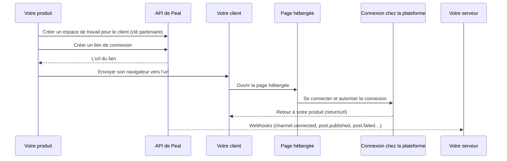

Un de vos produits peut publier sur les plateformes sociales pour ses propres clients à travers Peal, sans qu’aucun d’eux ait un compte Peal ni voie l’application de Peal.

| Élément                          | Ce que c’est                                                    |
| -------------------------------- | --------------------------------------------------------------- |
| [Compte partenaire](#account)    | Ce que vous détenez                                             |
| [Espace de travail](#workspaces) | Un pour chacun de vos clients, que possède le compte partenaire |
| Clé partenaire                   | Ce avec quoi votre serveur agit dans ces espaces de travail     |
| [Page hébergée](#connect)        | Là où vous envoyez vos clients connecter leurs comptes sociaux  |
| [Webhooks](/developers/webhooks) | La façon dont Peal dit à votre serveur ce qui se passe          |



L’espace de travail est l’unité que Peal isole : ses canaux, ses publications, ses médias, ses statistiques et ses webhooks n’appartiennent qu’à lui, et le supprimer les efface tous. En donner un à chaque client tient les comptes et les publications de l’un hors de portée de tous les autres, par construction plutôt que par un filtre dans votre code.

## Obtenir un compte partenaire [#account]

Un compte partenaire appartient à l’un de vos espaces de travail, son espace de travail principal : celui avec lequel vous vous êtes inscrit, où se trouvent les membres de votre équipe. Les propriétaires et administrateurs de cet espace gèrent le compte.

- Sur Peal Cloud, les comptes partenaires sont ouverts par l’équipe de Peal : écrivez-nous en disant ce que vous construisez.
- Sur un Peal auto-hébergé, l’équipe en accorde un depuis la [console d’administration](/self-hosting/staff#partners), sur la page d’un espace de travail. Mettre [`PEAL_PARTNER_SELF_SERVICE`](/self-hosting/environment-variables#sign-in) à `true` laisse les propriétaires et administrateurs de n’importe quel espace de travail en ouvrir un eux-mêmes, sous **Paramètres**, puis **Partenaire**.

Réglez-le ensuite sous **Paramètres**, puis **Partenaire**, dans l’application web :

<Steps>
  <Step title="Nom et logo">
    Ce que vos clients lisent sur les pages hébergées : un nom de 80 caractères
    au plus, et l’adresse HTTPS d’un logo, que leur navigateur charge depuis
    votre serveur.
  </Step>
  <Step title="Origines de retour">
    Les origines vers lesquelles une page hébergée peut renvoyer vos clients,
    comme `https://app.example.com` : schéma, hôte et port, sans rien après, 20
    au plus. Le simple `http://` n’est accepté que pour `localhost`, pour
    essayer le parcours en développement. Une page hébergée revient à une
    adresse située sur l’une de ces origines, exactement, et nulle part
    ailleurs.
  </Step>
  <Step title="Une clé partenaire">
    Son nom, ce qu’elle peut faire de vos espaces de travail et ce qu’elle peut
    faire dans chacun. La clé est affichée une seule fois : rangez-la dans les
    secrets de votre serveur.
  </Step>
</Steps>

### Clés partenaires [#keys]

Une clé partenaire commence par `peal_partner_`, et s’envoie en `Authorization: Bearer peal_partner_…`. Seul un propriétaire ou un administrateur connecté en crée une, dans l’application web : aucune clé ni aucune application ne crée de clés. Révoquez-en une au même endroit, ou avec `DELETE /api/workspaces/{workspaceId}/partner/keys/{partnerKeyId}` ; elle cesse de fonctionner aussitôt.

| Portée d’une clé    | Ce qu’elle permet                                           |
| ------------------- | ----------------------------------------------------------- |
| `workspaces:read`   | Lister et lire les espaces de travail que possède le compte |
| `workspaces:write`  | Les créer, les renommer, changer leur identifiant externe   |
| `workspaces:delete` | En supprimer un, avec tout ce qu’il contient                |

Dans chaque espace de travail qu’il possède, une clé partenaire détient les [permissions](/guides/posts#roles) que vous avez cochées, parmi celles dont un produit a besoin pour ses clients :

- `channel:*`, `media:*`, `post:*`, `analytics:read`, `assistant:use`, `webhook:*` et `billing:read` ;
- `engagement:read` et `engagement:reply` : les [commentaires](/guides/engage/inbox) sous les publications d’un client, et y répondre en public au nom de son compte. Ces commentaires ont été écrits par d’autres personnes : ne les donnez donc à une clé que si votre produit les montre ou y répond ;
- `engagement:message` : répondre en privé, au nom du compte, aux [messages privés](/guides/engage/inbox#direct-messages) que reçoivent les comptes Mastodon et Bluesky d’un client, que `engagement:read` lit. Les messages sont une correspondance privée : ne donnez ces permissions à une clé que si votre produit les montre ou y répond ;
- `assistant:configure`, pour régler le [fournisseur d’images](/guides/workspace#image-provider) de chaque client : `PUT /api/workspaces/{workspaceId}/assistant/image-provider`, avec la clé du client, un espace de travail à la fois ;
- `activity:read`, qui lit le [journal d’activité](/guides/workspace#activity) de l’espace de travail : ce que votre clé a demandé d’y changer, et les comptes connectés par des liens de connexion.

Une clé partenaire ne détient jamais ce qui revient aux personnes : les membres, les invitations, les clés d’API, les changements de facturation.

### Ce qu’atteint une clé partenaire [#isolation]

| Avec une clé partenaire                                                    | Réponse                           |
| -------------------------------------------------------------------------- | --------------------------------- |
| Un espace de travail que possède son compte partenaire                     | Ce que ses permissions autorisent |
| Un espace de travail que possède un autre partenaire                       | 404, comme s’il n’existait pas    |
| Tout autre espace de travail, votre espace principal compris               | 404                               |
| `/api/me`, les membres, invitations et clés d’API de n’importe quel espace | 403                               |

Dans l’autre sens, une clé d’API d’un espace de travail, la session d’un membre ou un jeton OAuth n’appelle jamais `/api/partner` : 403.

La [validation en deux étapes](/guides/workspace#require-two-step) concerne les personnes. Les clés partenaires et les espaces de travail de vos clients, qui n’ont aucun membre, n’en dépendent pas, tandis que les propriétaires de votre espace de travail principal peuvent l’exiger de ses membres comme dans tout espace de travail.

## Créer un espace de travail pour chaque client [#workspaces]

Quand un client s’inscrit chez vous, créez son espace de travail, avec votre propre identifiant pour lui comme `externalId`. Peal le conserve, retrouve l’espace par lui, et l’écrit dans chaque [webhook](/developers/embedding/operate#webhooks) de cet espace : vous ne tenez aucune table de correspondance entre vos identifiants et ceux de Peal.

<CodeGroup>

```bash curl
curl -X POST https://api.example.com/api/partner/workspaces \
  -H "Authorization: Bearer $PEAL_PARTNER_KEY" \
  -H "Content-Type: application/json" \
  -H "Idempotency-Key: signup-cus_42" \
  -d '{"name": "Boulangerie Martin", "externalId": "cus_42"}'
```

```typescript TypeScript
import { PealClient } from "peal-sdk";

const peal = new PealClient({
  token: process.env.PEAL_PARTNER_KEY,
  baseUrl: "https://api.example.com",
});

const workspace = await peal.partner.createWorkspace({
  name: "Boulangerie Martin",
  externalId: "cus_42",
  "idempotency-key": "signup-cus_42",
});
// workspace.id est ce que tous les autres appels prennent comme workspaceId
```

```python Python
import os
from peal import Peal

peal = Peal(token=os.environ["PEAL_PARTNER_KEY"], base_url="https://api.example.com")

workspace = peal.partner.create_workspace(
    name="Boulangerie Martin",
    external_id="cus_42",
    idempotency_key="signup-cus_42",
)
```

</CodeGroup>

Une création peut être renvoyée sans risque, de deux façons :

| Par               | Ce qui se passe                                                                                                                                                                                           |
| ----------------- | --------------------------------------------------------------------------------------------------------------------------------------------------------------------------------------------------------- |
| `externalId`      | Il est unique parmi vos espaces de travail. Un second espace avec le même répond 409 `ExternalIdTaken`, dont le `workspaceId` est l’espace qui le porte : une inscription relancée n’en crée jamais deux. |
| `Idempotency-Key` | Pendant 24 heures, la même clé avec le même corps répond l’espace que la première requête a créé, et n’en crée pas d’autre ; la même clé avec un autre corps répond 409 `IdempotencyKeyReused`.           |

| Requête                                        | Ce qu’elle fait                                                                                                                                                              |
| ---------------------------------------------- | ---------------------------------------------------------------------------------------------------------------------------------------------------------------------------- |
| `GET /api/partner`                             | Le compte partenaire, et ce qu’il détient : espaces de travail et canaux, maintenant et à la fin de chacun des 35 derniers jours                                             |
| `GET /api/partner/workspaces`                  | Vos espaces de travail, du plus récent au plus ancien, chacun avec son nombre de canaux : `externalId` en trouve un exactement, `name` cherche, `limit` et `before` paginent |
| `POST /api/partner/workspaces`                 | En crée un                                                                                                                                                                   |
| `GET /api/partner/workspaces/{workspaceId}`    | En lit un                                                                                                                                                                    |
| `PATCH /api/partner/workspaces/{workspaceId}`  | Change son nom ou son identifiant externe (`null` le retire)                                                                                                                 |
| `DELETE /api/partner/workspaces/{workspaceId}` | Le supprime, avec tout ce qu’il contient ([Retirer un client](/developers/embedding/operate#offboard))                                                                       |

Une liste répond `total`, ce que les filtres trouvent en tout, et `next` : passez-le tel quel comme `before` pour la page suivante, jusqu’à ce qu’il soit null. C’est une position dans la liste, pas l’identifiant d’un espace de travail. Il reste valable quand les espaces qui le précèdent sont supprimés, et toute autre valeur de `before` répond 400.

```typescript
const { workspaces } = await peal.partner.listWorkspaces({
  externalId: "cus_42",
});
```

Un espace de travail que vous créez n’a pas de membres : personne ne s’y connecte, et seules vos clés y agissent.

## Laisser un client connecter ses comptes [#connect]

Votre client possède ses comptes sociaux, et lui seul peut s’y connecter. Vous créez un lien de connexion pour une plateforme, vous y envoyez son navigateur, et il revient dans votre produit une fois le compte connecté. Il ne voit jamais un champ de mot de passe chez vous, et Peal ne voit jamais son mot de passe non plus : c’est la page de connexion de la plateforme qui le demande.

<CodeGroup>

```typescript TypeScript
const { link, url } = await peal.connectLinks.create({
  workspaceId: workspace.id,
  platform: "linkedin",
  returnUrl: "https://app.example.com/settings/social",
  expiresInHours: 24,
  locale: "fr",
});
// Gardez link.id avec votre client ; redirigez son navigateur vers url.
```

```python Python
created = peal.connect_links.create(
    workspace_id=workspace.id,
    platform="linkedin",
    return_url="https://app.example.com/settings/social",
    expires_in_hours=24,
    locale="fr",
)
# created.link.id, created.url
```

</CodeGroup>

| Champ            | Ce que c’est                                                                                                                                                                                                                                                                                                                                             |
| ---------------- | -------------------------------------------------------------------------------------------------------------------------------------------------------------------------------------------------------------------------------------------------------------------------------------------------------------------------------------------------------- |
| `platform`       | L’une des plateformes que [l’instance connecte](/guides/channels#connect)                                                                                                                                                                                                                                                                                |
| `returnUrl`      | Où la page le renvoie une fois terminé. Son origine doit être l’une de vos [origines de retour](#account), exactement : 422 `ReturnUrlNotAllowed` sinon.                                                                                                                                                                                                 |
| `expiresInHours` | Combien de temps le lien fonctionne, de 1 à 720 (30 jours) : 168 (une semaine) par défaut                                                                                                                                                                                                                                                                |
| `locale`         | `en` ou `fr` : la langue dans laquelle la page s’ouvre. Sans elle, celle du visiteur.                                                                                                                                                                                                                                                                    |
| `channelId`      | Reconnecter ce canal au lieu de connecter un nouveau compte ([Reconnecter](#reconnect))                                                                                                                                                                                                                                                                  |
| `connection`     | La voie d’accès, sur les plateformes qui en ont plusieurs : pour Instagram, `instagramLogin` ou `facebookLogin` ([Instagram](/platforms/instagram#connect)) ; pour LinkedIn, `linkedinProfile` (le profil du membre) ou `linkedinPage` (les pages d’entreprise qu’il gère) ([LinkedIn](/platforms/linkedin#connect)). Sans elle, la première du serveur. |

L’`url` de la réponse est affichée une seule fois : Peal ne garde qu’une empreinte du jeton qu’elle contient. Demande `channel:connect`.

### Ce que voit votre client [#hosted-page]

<Steps>
  <Step title="Votre nom et votre logo">
    Avec une phrase : vous demandez à connecter son compte de cette plateforme,
    pour y publier pour lui. Pour Mastodon la page demande son serveur, pour
    Bluesky son identifiant.
  </Step>
  <Step title="La page de connexion de la plateforme">
    Il s’y connecte et autorise la connexion.
  </Step>
  <Step title="Un choix">
    Quand la connexion a atteint plusieurs comptes (les Pages que gère un
    utilisateur Facebook, les comptes Instagram qui leur sont liés, les chaînes
    YouTube d’un compte Google), il coche ceux à connecter.
  </Step>
  <Step title="Le retour à votre returnUrl">
    La page le renvoie vers votre produit.
  </Step>
</Steps>

La page est en anglais ou en français, ne montre rien de l’application de Peal, et dit que la connexion est assurée par Peal. Elle est tenue hors des moteurs de recherche.

### Quand il revient [#return]

Peal ajoute deux paramètres à votre `returnUrl`, à la place de ceux du même nom :

| Paramètre     | Valeur                                                                       |
| ------------- | ---------------------------------------------------------------------------- |
| `peal_link`   | L’identifiant du lien                                                        |
| `peal_status` | `connected`, `cancelled` (il a choisi de revenir sans connecter) ou `failed` |

<Callout type="warning" title="N’importe qui peut écrire ces paramètres">
  Prenez-les comme une invitation à regarder, jamais comme une preuve : lisez le
  lien avec votre clé.
</Callout>

```typescript
const link = await peal.connectLinks.get({ workspaceId, linkId });

if (link.status === "completed") {
  // link.channelIds : les canaux qu’il a connectés
}
```

| `status` d’un lien | Signification                                                                                   |
| ------------------ | ----------------------------------------------------------------------------------------------- |
| `pending`          | Il attend d’être utilisé. `failure` dit comment sa dernière connexion a fini, si elle a échoué. |
| `completed`        | Il a connecté les canaux de `channelIds`, et n’ouvre plus rien                                  |
| `revoked`          | Vous l’avez repris                                                                              |
| `expired`          | Son délai est passé                                                                             |

N’attendez pas le seul navigateur : un client peut fermer l’onglet avant de revenir. Abonnez-vous à [`channel.connected`](/developers/webhooks/events/channels#channel-connected), que Peal envoie quand le compte est connecté, avec le `workspaceExternalId` de l’espace de travail.

`DELETE /api/workspaces/{workspaceId}/connect-links/{linkId}` révoque un lien. `GET …/connect-links` liste ceux d’un espace de travail, ceux qui attendent et ceux terminés depuis moins de 30 jours.

### Reconnecter [#reconnect]

Quand une plateforme n’accepte plus l’autorisation d’un canal, Peal envoie [`channel.reconnect_needed`](/developers/webhooks/events/channels#channel-reconnect-needed). Créez un lien avec le `channelId` de ce canal. Sa page nomme le compte, et seule une connexion à ce même compte aboutit, si bien que le canal garde son identifiant, ses publications et ses statistiques.

### Ce qu’est un lien, et ce qu’il n’est pas [#link-security]

<Callout type="warning" title="Un lien est un moyen d’accès">
  Quiconque détient son adresse peut connecter un compte à lui à cet espace de
  travail tant qu’il n’est pas utilisé, révoqué ou expiré. Envoyez-y le
  navigateur de votre client depuis une page où il est connecté, ou par un canal
  de confiance. Donnez-lui la durée la plus courte qui convienne, et révoquez
  ceux dont vous n’avez plus besoin.
</Callout>

- Un lien sert une fois, par une connexion qui connecte un compte. L’ouvrir ne consomme rien : un aperçu de lien ne le dépense pas.
- Il ne donne rien d’autre. Il ne lit aucune publication, aucun canal ni aucun jeton, et n’atteint aucun autre espace de travail.
- Seul le navigateur qui a lancé la connexion la termine. La réponse de la plateforme, rejouée dans un autre navigateur, ne connecte rien.
- Il ne revient que là où vous l’avez dit. Un `returnUrl` sur une origine que vous n’avez pas enregistrée est refusé à la création du lien : un lien n’envoie jamais personne sur le site de quelqu’un d’autre.
- La connexion d’un lien peut être lancée 20 fois, et un espace de travail a 100 liens en attente au plus.

Après une connexion, montrez à votre client quel compte a été connecté (`GET …/channels` donne son identifiant), pour qu’il voie si ce n’est pas celui qu’il voulait.
