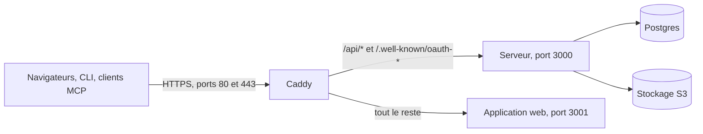

Un Peal auto-hébergé fait tourner deux programmes à lui, le serveur et l’application web, et a besoin de Postgres, d’un stockage objet compatible S3 et d’un moyen d’envoyer des e-mails. Peal accède à chaque service extérieur par un port doté d’une option par défaut auto-hébergeable, et tout le reste reste désactivé tant que vous ne le configurez pas.

<Callout type="warning" title="Avant la première version">
  Peal n’est pas encore sorti et aucune image n’est publiée : construisez-les
  depuis le dépôt, comme le montre [Avec Docker Compose et Caddy](#compose).
  Cette page décrit le modèle d’auto-hébergement que suit le code, et toutes les
  valeurs indiquées sont des exemples.
</Callout>

## Services [#services]

| Service        | Requis     | Usage dans Peal                                                                                                                                     | Options                                                                                                                                                                     |
| -------------- | ---------- | --------------------------------------------------------------------------------------------------------------------------------------------------- | --------------------------------------------------------------------------------------------------------------------------------------------------------------------------- |
| Postgres       | Oui        | Toutes les données, et les tâches durables qui diffusent les publications et renouvellent les jetons des plateformes. Peal n’a pas besoin de Redis. | N’importe quel serveur Postgres ([Base de données](/self-hosting/database))                                                                                                 |
| Stockage objet | Oui        | Médias importés                                                                                                                                     | N’importe quelle API compatible S3 ([Stockage des médias](/self-hosting/storage))                                                                                           |
| E-mail         | Oui        | Confirmer les adresses e-mail, réinitialiser les mots de passe, inviter, et envoyer les notifications sur les publications et les canaux            | Resend, ou n’importe quel serveur SMTP ([E-mail](/self-hosting/email))                                                                                                      |
| Facturation    | Facultatif | Offres et abonnements                                                                                                                               | Stripe. Sans clé, la facturation est désactivée et aucune limite d’offre ne s’applique.                                                                                     |
| Captcha        | Facultatif | Protection contre les robots à l’inscription et à la réinitialisation du mot de passe                                                               | Cloudflare Turnstile. Sans ses clés, le captcha est désactivé.                                                                                                              |
| IA             | Facultatif | L’assistant de rédaction de l’éditeur, et les images qu’il crée                                                                                     | L’API d’Anthropic, ou n’importe quel point d’accès compatible OpenAI ; un point d’accès d’images compatible OpenAI pour les images. Sans fournisseur, chacun est désactivé. |
| Télémétrie     | Facultatif | Journaux, métriques et traces                                                                                                                       | N’importe quel collecteur OpenTelemetry (OTLP). Rien n’est exporté sans point d’accès configuré.                                                                            |

Le déploiement de Peal stocke les médias sur Cloudflare R2, et son environnement de développement utilise SeaweedFS pour le stockage et Mailpit pour l’e-mail. Une instance auto-hébergée peut utiliser ceux-ci, ou tout autre stockage et serveur de messagerie qui parle les mêmes protocoles.

## Ce qu’il faut faire tourner [#run]

| Programme                      | Ce qu’il fait                                                                                                                                                                                                                                                                              |
| ------------------------------ | ------------------------------------------------------------------------------------------------------------------------------------------------------------------------------------------------------------------------------------------------------------------------------------------ |
| Le serveur (`peal-server`)     | L’API HTTP sous `/api`, la connexion sous `/api/auth`, le point d’accès MCP à `/api/mcp`, et les tâches qui diffusent les publications, envoient les notifications par e-mail et renouvellent les jetons. Son image écoute sur le port 3000 et tourne sous un utilisateur sans privilèges. |
| L’application web (`peal-web`) | Toutes les pages, sur Node. Elle transmet `/api/*` et les documents de découverte OAuth (`/.well-known/oauth-*`) au serveur, à `PEAL_API_URL`.                                                                                                                                             |

Les personnes, la ligne de commande et les clients MCP utilisent tous une seule adresse, `PUBLIC_URL`. Avec la pile Compose ci-dessous, Caddy route chaque requête :



<Callout type="warning" title="Un seul processus serveur par instance">
  Les clients MCP des anciennes révisions du protocole gardent leurs sessions
  dans la mémoire du serveur. Chaque processus qui tourne a besoin de son propre
  `HOSTNAME`.
</Callout>

En production (`NODE_ENV=production`, que l’image du serveur définit), le serveur refuse de démarrer sans ces variables, et son erreur nomme celle qui manque :

| Variable                                                                                   | Ce que c’est                                                   | Détails                                                  |
| ------------------------------------------------------------------------------------------ | -------------------------------------------------------------- | -------------------------------------------------------- |
| `DATABASE_URL`                                                                             | La base de données Postgres                                    | [Essentiel](/self-hosting/environment-variables#core)    |
| `PUBLIC_URL`                                                                               | L’adresse où l’on ouvre Peal, comme `https://peal.example.com` | [Essentiel](/self-hosting/environment-variables#core)    |
| `BETTER_AUTH_SECRET`                                                                       | Le secret qui signe les sessions : `openssl rand -base64 32`   | [Connexion](/self-hosting/environment-variables#sign-in) |
| `AUTH_IP_HEADERS`                                                                          | L’en-tête où votre frontal met l’adresse du client             | [Connexion](/self-hosting/environment-variables#sign-in) |
| `MAIL_FROM`, et `SMTP_URL` ou `RESEND_API_KEY`                                             | L’expéditeur des e-mails, et le moyen de les envoyer           | [E-mail](/self-hosting/environment-variables#email)      |
| `PEAL_S3_ENDPOINT`, `PEAL_S3_BUCKET`, `PEAL_S3_ACCESS_KEY_ID`, `PEAL_S3_SECRET_ACCESS_KEY` | Le stockage des médias                                         | [Médias](/self-hosting/environment-variables#media)      |

L’application web a besoin de `PEAL_API_URL`. Pour connecter des canaux, le serveur a aussi besoin de `PEAL_TOKEN_KEYS`. [Variables d’environnement](/self-hosting/environment-variables) liste chaque réglage, avec sa valeur par défaut.

## Avec Docker Compose et Caddy [#compose]

Le dossier `packages/peal-docker` du dépôt contient une pile à faire tourner telle quelle :

- `compose.production.yaml` fait tourner Postgres, le serveur, l’application web et une pile de télémétrie (un collecteur OpenTelemetry, Loki, Tempo, Prometheus et Grafana), chacun redémarré s’il s’arrête, avec chaque port sur `127.0.0.1`.
- `compose.self-host.yaml` place Caddy devant eux. Caddy obtient un certificat auprès de Let’s Encrypt, et c’est le seul service joignable de l’extérieur, sur les ports 80 et 443.

<Steps>
  <Step title="Faire pointer votre domaine vers le serveur">
    Ajoutez l’enregistrement DNS, et ouvrez les ports 80 et 443.
  </Step>
  <Step title="Remplir les réglages">
    Copiez `self-host.env.example` hors du dépôt, par exemple vers
    `/srv/peal/peal.env`, et ne laissez que root le lire. Remplissez-le : le
    domaine, les secrets qu’il dit comment générer, l’e-mail et le stockage des
    médias.
  </Step>
  <Step title="Construire les images et démarrer la pile">
    Depuis `packages/peal-docker` :

    ```sh
    docker compose --project-name peal --file compose.production.yaml \
      --file compose.self-host.yaml --env-file /srv/peal/peal.env build
    docker compose --project-name peal --file compose.production.yaml \
      --file compose.self-host.yaml --env-file /srv/peal/peal.env up --detach --wait
    ```

  </Step>
</Steps>

Caddy (`self-host/Caddyfile`) envoie `/api/*` et `/.well-known/oauth-*` au serveur et tout le reste à l’application web. Il attend une réponse 150 secondes, plus longtemps que l’assistant de rédaction et la transmission de l’application web. Définissez `AUTH_IP_HEADERS=x-forwarded-for`, comme le fait le fichier d’exemple.

### Mettre à jour [#upgrade]

Le serveur applique ses migrations au démarrage : une mise à jour, c’est une extraction plus récente du dépôt et les deux mêmes commandes. Compose laisse au serveur ses 75 secondes pour s’arrêter.

Un serveur qui facture donne aussi à Stripe le [catalogue](/self-hosting/options#billing) de la nouvelle version entre les deux, après `build` et avant `up`, avec les mêmes fichiers :

```sh
docker compose --project-name peal --file compose.production.yaml \
  --file compose.self-host.yaml --env-file /srv/peal/peal.env \
  run --rm --no-deps server packages/peal-server/scripts/stripe-catalogue.ts
```

Elle ne change rien quand Stripe le détient déjà. Un serveur dont le catalogue diffère refuse de démarrer, et consigne les écarts avec cette commande. Un serveur déjà démarré ne relit le catalogue qu’à son redémarrage.

### Grafana [#grafana]

Grafana n’écoute que sur `127.0.0.1:13000`. Joignez-le par un tunnel SSH, puis connectez-vous en `admin` avec `GRAFANA_ADMIN_PASSWORD` :

```sh
ssh -L 13000:127.0.0.1:13000 you@your-server
```

Ses règles d’alerte sont fournies, et ne préviennent personne tant que vous n’ajoutez pas de point de contact.

### Sauvegardes [#backups]

Définissez `PEAL_POSTGRES_ARCHIVE_MODE=on` et les réglages `PGBACKREST_REPO1_*` que liste le fichier d’exemple. Postgres archive alors ses journaux de transactions (WAL) dans ce bucket avec pgBackRest, que fournit l’image Postgres de la pile. Créez le dépôt de sauvegarde une fois, puis lancez des sauvegardes complètes à intervalles réguliers :

```sh
docker compose … exec --user postgres postgres pgbackrest stanza-create
docker compose … exec --user postgres postgres pgbackrest backup --type=full
```

Les serveurs de Peal le font avec l’Ansible de `packages/peal-infra/ansible`, dont le README et la procédure de restauration montrent chaque commande. [Variables d’environnement](/self-hosting/environment-variables#compose) liste les réglages de la pile.

<Callout type="warning" title="Après une restauration">
  Appliquez le registre des effacements avant de démarrer le serveur, sinon les
  comptes et espaces de travail supprimés depuis la sauvegarde reviennent
  ([Suppressions et sauvegardes](/self-hosting/privacy#erasure-ledger)).
</Callout>

### Mémoire de Postgres [#postgres-memory]

Postgres démarre avec les réglages de mémoire de PostgreSQL lui-même, dont 128 Mo de tampons, quelle que soit la mémoire du serveur. Pour lui en donner plus, définissez `PEAL_POSTGRES_SHARED_BUFFERS`, `PEAL_POSTGRES_EFFECTIVE_CACHE_SIZE`, `PEAL_POSTGRES_MAINTENANCE_WORK_MEM` et `PEAL_POSTGRES_RANDOM_PAGE_COST` ([Variables d’environnement](/self-hosting/environment-variables#compose) dit ce que fait chacun). Dimensionnez-les sur la mémoire que Postgres peut avoir, pas sur celle de la machine : le serveur, l’application web et la pile de télémétrie la partagent. Compose recrée Postgres quand l’un d’eux change, et Peal est indisponible le temps qu’il redémarre.

<Callout type="warning" title="Avant de mettre à jour">
  Postgres lit ces réglages sur sa ligne de commande, qui l’emporte sur `ALTER
  SYSTEM` et `postgresql.conf`. Lisez les valeurs actuelles, et reportez dans sa
  variable toute valeur qui diffère de la valeur par défaut des [Variables
  d’environnement](/self-hosting/environment-variables#compose), sinon elle est
  perdue.
</Callout>

```sql
SELECT name, setting, source FROM pg_settings WHERE name IN ('shared_buffers', 'effective_cache_size', 'maintenance_work_mem', 'random_page_cost');
```

## Devant Peal [#reverse-proxy]

Placez devant l’application web un proxy inverse qui termine TLS, comme Caddy, et n’exposez que le proxy. Envoyez toutes les requêtes à l’application web, qui transmet les chemins du serveur, ou envoyez `/api/*` et `/.well-known/oauth-*` directement au serveur et tout le reste à l’application web.

### L’adresse du client [#client-address]

La connexion est limitée en débit par adresse du client, que le serveur lit dans l’en-tête que nomme `AUTH_IP_HEADERS`. Ne nommez qu’un en-tête que votre frontal définit en remplaçant ce que le client a envoyé :

| Derrière                                                                                                 | `AUTH_IP_HEADERS`  | À définir aussi                                                                                               |
| -------------------------------------------------------------------------------------------------------- | ------------------ | ------------------------------------------------------------------------------------------------------------- |
| Cloudflare                                                                                               | `cf-connecting-ip` |                                                                                                               |
| Caddy, qui remplace `X-Forwarded-For` sauf si on lui dit de faire confiance aux proxies placés avant lui | `x-forwarded-for`  |                                                                                                               |
| Des proxies qui ajoutent à `X-Forwarded-For`                                                             | `x-forwarded-for`  | `AUTH_TRUSTED_PROXIES` avec leurs adresses, pour que l’adresse du client soit lue depuis la droite, après eux |

<Callout type="warning" title="Placez un proxy devant">
  L’application web transmet ces en-têtes tels qu’ils arrivent. Sans proxy
  devant elle, aucune adresse n’est fiable, et les limites ne distinguent pas
  les clients.
</Callout>

### Délais et sondes [#probes]

Laissez les requêtes durer au moins 90 secondes à travers tout ce qui sépare les navigateurs du serveur, tunnel compris : l’assistant de rédaction attend jusque-là son fournisseur d’IA. L’application web, quand elle transmet `/api/*`, attend jusqu’à 120 secondes.

Le serveur répond à deux sondes :

| Sonde             | Répond                                                                                                                                | Convient à                                                       |
| ----------------- | ------------------------------------------------------------------------------------------------------------------------------------- | ---------------------------------------------------------------- |
| `GET /api/health` | `204 No Content` dès que le serveur a démarré, quel que soit l’état de sa base de données                                             | Un contrôle de santé de conteneur ; l’image du serveur l’utilise |
| `GET /api/ready`  | `204 No Content` quand la base de données répond elle aussi, et `503 Service Unavailable` avec une erreur `DatabaseUnavailable` sinon | Un répartiteur de charge qui retient le trafic jusque-là         |

## Liens courts [#short-links]

Les [liens courts](/guides/posts/published#short-links) sont désactivés tant que `PEAL_SHORT_LINK_BASE` n’indique pas où ils se trouvent :

| Où                    | `PEAL_SHORT_LINK_BASE`           | Quoi d’autre                                                                                                                                                                                              |
| --------------------- | -------------------------------- | --------------------------------------------------------------------------------------------------------------------------------------------------------------------------------------------------------- |
| Sur l’adresse de Peal | `https://<votre domaine>/api/l/` | Rien : le serveur répond à `/api/l/<code>`, que l’application web transmet.                                                                                                                               |
| Sur un domaine à eux  | `https://go.example.com/`        | Son proxy envoie chaque `/<code>` (sept lettres et chiffres) vers `/api/l/<code>` du serveur, et répond 404 au reste. `self-host/Caddyfile` en contient le bloc, commenté, avec `PEAL_SHORT_LINK_DOMAIN`. |

Un domaine à part tient les redirections à l’écart de l’adresse où l’on se connecte, au cas où une plateforme verrait d’un mauvais œil un hôte qui redirige.

<Callout type="warning" title="Changer la base">
  Changer ou retirer la base fait cesser de fonctionner les liens courts déjà
  envoyés.
</Callout>

Le domaine court doit atteindre le serveur par la même frontière que l’application, qui pose l’en-tête que nomme `AUTH_IP_HEADERS` et remplace ce que le client a envoyé. Sans elle, tous les visiteurs partagent l’adresse du proxy et la limite ci-dessous ; avec un en-tête que le client peut poser, la limite ne borne rien. La base doit être un domaine public que les plateformes reconnaissent comme lien : les liens courts ne s’essaient donc pas sur localhost.

Une redirection est une `302` avec `Cache-Control: no-store`, pour que chaque visite atteigne le serveur et soit comptée, et `X-Robots-Tag: noindex, nofollow`. Chaque adresse peut suivre 300 liens courts par minute (dans chaque processus du serveur), au-delà elle reçoit `429` ; cela borne la recherche de codes au hasard, pas les clics. Le serveur journalise le chemin, avec son code, comme tout chemin, et jamais la destination d’un lien.

<Accordion>
  <AccordionItem title="Un proxy qui ne sait pas réécrire les chemins">
    Si le proxy devant le serveur ne sait pas réécrire les chemins, comme un
    tunnel qui ne fait que les router, réécrivez `/<code>` en `/api/l/<code>` en
    amont, à la périphérie. Laissez le tunnel n’envoyer au serveur que `/api/l/`
    suivi de sept lettres et chiffres, et répondre 404 à tout le reste du
    domaine court, pour qu’aucun de ses chemins n’atteigne le reste du serveur.
    C’est ainsi que le service de Peal route peal.link.
  </AccordionItem>
</Accordion>

## Arrêt [#stopping]

À l’arrêt, le serveur attend jusqu’à 60 secondes que les appels en cours aux plateformes répondent. Laissez-lui au moins 75 secondes avant de l’interrompre, avec `docker stop --time 75` ou `stop_grace_period: 75s` dans Compose.

Un appel coupé est vérifié au redémarrage du serveur : sur Bluesky en relisant la publication, sur Mastodon en la renvoyant sous la même clé, que Mastodon garde une heure. Quand cela ne tranche pas, la publication est marquée à vérifier, et quelqu’un doit regarder sur la plateforme.

## La ligne de commande et les clients MCP [#mcp]

La [ligne de commande](/developers/cli) se connecte avec un code que l’on approuve à `PUBLIC_URL/device`, et n’a besoin de rien d’autre.

Les [clients MCP](/developers/mcp) se connectent avec OAuth, qui demande `PUBLIC_URL` en HTTPS, ou sur `localhost` pour le développement. Sur une adresse en HTTP simple ailleurs, comme `http://192.168.1.20:3001`, le serveur démarre, journalise un avertissement, et son point d’accès MCP refuse toutes les requêtes.

La plupart des clients MCP s’enregistrent eux-mêmes avant de se connecter, ce que le serveur n’autorise qu’avec `MCP_DYNAMIC_REGISTRATION=true`. N’importe qui peut alors enregistrer un client, sous n’importe quel nom : la page de consentement prévient que Peal ne l’a pas vérifié, et indique où il renvoie ensuite.

## Comptes d’équipe [#staff]

L’équipe, le rôle d’administrateur de Better Auth, fait tourner le serveur depuis la [console de l’équipe](/self-hosting/staff) à `/admin`. Elle trouve des comptes et des espaces de travail, bannit ou déconnecte des comptes, renvoie une confirmation, et agit à la place d’un membre pendant une heure, chaque action étant inscrite à un journal d’audit. Les points d’accès d’administration de Better Auth sont désactivés, sauf pour cesser d’agir à la place d’un membre.

Donnez ce rôle à un compte dans la base de données, puis reconnectez-vous :

```sql
UPDATE auth."user" SET role = 'admin' WHERE email = 'you@example.com';
```

L’équipe ne peut pas supprimer un compte : seul son titulaire le peut, depuis [ses paramètres de compte](/guides/workspace/account#delete-account), ce qui supprime ce que Peal conserve à son sujet.

En se faisant passer pour un membre, l’équipe ne peut ni connecter de canaux, ni publier, ni gérer les clés d’API ou la facturation, ni modifier les espaces de travail, ni laisser une application agir pour le membre. Elle peut lire les notifications du membre, mais pas les marquer comme lues ni changer ses préférences d’e-mail. Elle peut demander de l’aide à l’assistant de rédaction dans les espaces de travail du membre, ce qui compte dans les demandes du jour de ces espaces.
