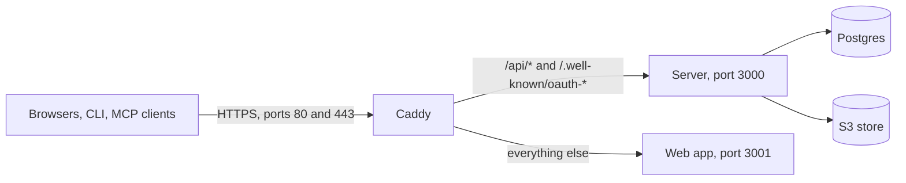

A self-hosted Peal runs two programs of its own, the server and the web app, and needs Postgres, an S3-compatible object store and a way to send email. Peal reaches every outside service through a port with a self-hostable default, and everything else stays off until you configure it.

<Callout type="warning" title="Before the first release">
  Peal has not been released yet, and there are no published images to run:
  build them from the repository, as [With Docker Compose and Caddy](#compose)
  shows. This page describes the self-hosting model the code follows, and every
  value shown is an example.
</Callout>

## Services [#services]

| Service        | Needed   | What Peal uses it for                                                                                    | Options                                                                                                                       |
| -------------- | -------- | -------------------------------------------------------------------------------------------------------- | ----------------------------------------------------------------------------------------------------------------------------- |
| Postgres       | Yes      | All data, and the durable jobs that publish posts and refresh platform tokens. Peal needs no Redis.      | Any Postgres server ([Database](/self-hosting/database))                                                                      |
| Object storage | Yes      | Uploaded media                                                                                           | Any S3-compatible API ([Media storage](/self-hosting/storage))                                                                |
| Email          | Yes      | Confirming email addresses, resetting passwords, invitations, and notifications about posts and channels | Resend, or any SMTP server ([Email](/self-hosting/email))                                                                     |
| Billing        | Optional | Plans and subscriptions                                                                                  | Stripe. Without a key, billing is off and no plan limits apply.                                                               |
| Captcha        | Optional | Bot protection on sign-up and password resets                                                            | Cloudflare Turnstile. Without its keys, the captcha is off.                                                                   |
| AI             | Optional | The writing assistant in the composer, and the images it makes                                           | Anthropic's API, or any OpenAI-compatible endpoint; an OpenAI-compatible image endpoint for images. Without one, each is off. |
| Telemetry      | Optional | Logs, metrics and traces                                                                                 | Any OpenTelemetry (OTLP) collector. Nothing is exported unless an endpoint is set.                                            |

Peal's own deployment stores media on Cloudflare R2, and its development stack runs SeaweedFS for storage and Mailpit for email. A self-hosted instance can use any of these, or any other store and mail server that speaks the same protocols.

## What to run [#run]

| Program                    | What it does                                                                                                                                                                                                                    |
| -------------------------- | ------------------------------------------------------------------------------------------------------------------------------------------------------------------------------------------------------------------------------- |
| The server (`peal-server`) | The HTTP API under `/api`, sign-in under `/api/auth`, the MCP endpoint at `/api/mcp`, and the jobs that publish posts, email notifications and refresh tokens. Its image listens on port 3000 and runs as an unprivileged user. |
| The web app (`peal-web`)   | Every page, on Node. It forwards `/api/*` and the OAuth discovery documents (`/.well-known/oauth-*`) to the server at `PEAL_API_URL`.                                                                                           |

People, the command line and MCP clients all use one address, `PUBLIC_URL`. With the Compose stack below, Caddy routes each request:



<Callout type="warning" title="One server process per instance">
  MCP clients on older protocol revisions keep their sessions in the server's
  memory. Each process that runs needs its own `HOSTNAME`.
</Callout>

In production (`NODE_ENV=production`, which the server's image sets), the server refuses to start without these, and its error names the variable missing:

| Variable                                                                                   | What it is                                                          | Details                                                |
| ------------------------------------------------------------------------------------------ | ------------------------------------------------------------------- | ------------------------------------------------------ |
| `DATABASE_URL`                                                                             | The Postgres database                                               | [Core](/self-hosting/environment-variables#core)       |
| `PUBLIC_URL`                                                                               | The address people open Peal at, such as `https://peal.example.com` | [Core](/self-hosting/environment-variables#core)       |
| `BETTER_AUTH_SECRET`                                                                       | The secret that signs sessions: `openssl rand -base64 32`           | [Sign-in](/self-hosting/environment-variables#sign-in) |
| `AUTH_IP_HEADERS`                                                                          | The header your edge puts the client's address in                   | [Sign-in](/self-hosting/environment-variables#sign-in) |
| `MAIL_FROM`, and `SMTP_URL` or `RESEND_API_KEY`                                            | Who emails come from, and how they leave                            | [Email](/self-hosting/environment-variables#email)     |
| `PEAL_S3_ENDPOINT`, `PEAL_S3_BUCKET`, `PEAL_S3_ACCESS_KEY_ID`, `PEAL_S3_SECRET_ACCESS_KEY` | The media store                                                     | [Media](/self-hosting/environment-variables#media)     |

The web app needs `PEAL_API_URL`. To connect channels, the server also needs `PEAL_TOKEN_KEYS`. [Environment variables](/self-hosting/environment-variables) lists every setting, with its default.

## With Docker Compose and Caddy [#compose]

The repository's `packages/peal-docker` folder holds a stack you can run as it is:

- `compose.production.yaml` runs Postgres, the server, the web app and a telemetry stack (an OpenTelemetry collector, Loki, Tempo, Prometheus and Grafana), each restarted when it stops, with every port on `127.0.0.1`.
- `compose.self-host.yaml` adds Caddy in front of them. Caddy gets a certificate from Let's Encrypt, and it is the only service reachable from outside, on ports 80 and 443.

<Steps>
  <Step title="Point your domain at the server">
    Add the DNS record, and open ports 80 and 443.
  </Step>
  <Step title="Fill in the settings">
    Copy `self-host.env.example` out of the repository, such as to
    `/srv/peal/peal.env`, and let only root read it. Fill it in: the domain, the
    secrets it says how to generate, email and the media store.
  </Step>
  <Step title="Build the images and start the stack">
    From `packages/peal-docker`:

    ```sh
    docker compose --project-name peal --file compose.production.yaml \
      --file compose.self-host.yaml --env-file /srv/peal/peal.env build
    docker compose --project-name peal --file compose.production.yaml \
      --file compose.self-host.yaml --env-file /srv/peal/peal.env up --detach --wait
    ```

  </Step>
</Steps>

Caddy (`self-host/Caddyfile`) sends `/api/*` and `/.well-known/oauth-*` to the server and everything else to the web app. It waits 150 seconds for an answer, longer than the writing assistant and the web app's forwarding wait. Set `AUTH_IP_HEADERS=x-forwarded-for`, as the example file does.

### Upgrade [#upgrade]

The server applies its migrations as it starts, so an upgrade is a newer checkout and the same two commands. Compose gives the server its 75 seconds to stop.

A server that bills also gives Stripe the new release's [catalogue](/self-hosting/options#billing) between the two, after `build` and before `up`, with the same files:

```sh
docker compose --project-name peal --file compose.production.yaml \
  --file compose.self-host.yaml --env-file /srv/peal/peal.env \
  run --rm --no-deps server packages/peal-server/scripts/stripe-catalogue.ts
```

It changes nothing when Stripe already holds it. Until per-account pricing is sold, a server whose catalogue differs starts all the same and logs what differs with this command.

### Grafana [#grafana]

Grafana listens on `127.0.0.1:13000` only. Reach it through an SSH tunnel, then sign in as `admin` with `GRAFANA_ADMIN_PASSWORD`:

```sh
ssh -L 13000:127.0.0.1:13000 you@your-server
```

Its alert rules come provisioned, and notify no one until you add a contact point.

### Backups [#backups]

Set `PEAL_POSTGRES_ARCHIVE_MODE=on` and the `PGBACKREST_REPO1_*` settings the example file lists. Postgres then archives its write-ahead log to that bucket with pgBackRest, which the stack's Postgres image ships. Create the backup repository once, then take full backups on a schedule:

```sh
docker compose … exec --user postgres postgres pgbackrest stanza-create
docker compose … exec --user postgres postgres pgbackrest backup --type=full
```

Peal's own servers do so with the Ansible in `packages/peal-infra/ansible`, whose README and restore runbook show every command. [Environment variables](/self-hosting/environment-variables#compose) lists the stack's settings.

<Callout type="warning" title="After a restore">
  Apply the erasure ledger before you start the server, or the accounts and
  workspaces deleted since the backup come back ([Deletions and
  backups](/self-hosting/privacy#erasure-ledger)).
</Callout>

### Postgres memory [#postgres-memory]

Postgres starts with PostgreSQL's own memory settings, 128 MB of buffers among them, whatever the server has. To give it more, set `PEAL_POSTGRES_SHARED_BUFFERS`, `PEAL_POSTGRES_EFFECTIVE_CACHE_SIZE`, `PEAL_POSTGRES_MAINTENANCE_WORK_MEM` and `PEAL_POSTGRES_RANDOM_PAGE_COST` ([Environment variables](/self-hosting/environment-variables#compose) says what each one does). Size them on the memory Postgres may have, not the machine's: the server, the web app and the telemetry stack share it. Compose recreates Postgres when one of them changes, and Peal is unavailable for the seconds it takes to restart.

<Callout type="warning" title="Before upgrading">
  Postgres takes these settings from its command line, which wins over `ALTER
  SYSTEM` and `postgresql.conf`. Read the current values, and give each one
  whose value differs from the default on [Environment
  variables](/self-hosting/environment-variables#compose) that value in its
  variable, or it is lost.
</Callout>

```sql
SELECT name, setting, source FROM pg_settings WHERE name IN ('shared_buffers', 'effective_cache_size', 'maintenance_work_mem', 'random_page_cost');
```

## In front of Peal [#reverse-proxy]

Run a reverse proxy that terminates TLS, such as Caddy, in front of the web app, and expose only the proxy. Either send every request to the web app, which forwards the server's paths, or send `/api/*` and `/.well-known/oauth-*` straight to the server and everything else to the web app.

### The client's address [#client-address]

Sign-in is rate limited by the client's address, which the server reads from the header `AUTH_IP_HEADERS` names. Name only a header your edge sets and replaces whatever the client sent:

| Behind                                                                             | `AUTH_IP_HEADERS`  | Also set                                                                                               |
| ---------------------------------------------------------------------------------- | ------------------ | ------------------------------------------------------------------------------------------------------ |
| Cloudflare                                                                         | `cf-connecting-ip` |                                                                                                        |
| Caddy, which replaces `X-Forwarded-For` unless told to trust the proxies before it | `x-forwarded-for`  |                                                                                                        |
| Proxies that append to `X-Forwarded-For`                                           | `x-forwarded-for`  | `AUTH_TRUSTED_PROXIES` with their addresses, so the client's address is read from the right, past them |

<Callout type="warning" title="Put a proxy in front">
  The web app passes these headers on as they come. With no proxy in front of
  it, there is no address to trust, and rate limits cannot tell clients apart.
</Callout>

### Timeouts and probes [#probes]

Let requests last at least 90 seconds through everything between browsers and the server, a tunnel included: the writing assistant waits that long for its AI provider. The web app's own forwarding of `/api/*` waits up to 120 seconds.

The server answers two probes:

| Probe             | Answers                                                                                                                               | Suits                                                  |
| ----------------- | ------------------------------------------------------------------------------------------------------------------------------------- | ------------------------------------------------------ |
| `GET /api/health` | `204 No Content` as soon as the server is up, whatever the state of its database                                                      | A container health check; the server's image checks it |
| `GET /api/ready`  | `204 No Content` when the database answers as well, and `503 Service Unavailable` with a `DatabaseUnavailable` error when it does not | A load balancer holding traffic back until then        |

## Short links [#short-links]

[Short links](/guides/posts/published#short-links) are off until `PEAL_SHORT_LINK_BASE` says where they live:

| Where                    | `PEAL_SHORT_LINK_BASE`         | What else to do                                                                                                                                                                                             |
| ------------------------ | ------------------------------ | ----------------------------------------------------------------------------------------------------------------------------------------------------------------------------------------------------------- |
| On Peal's address        | `https://<your domain>/api/l/` | Nothing: the server answers `/api/l/<code>`, which the web app forwards.                                                                                                                                    |
| On a domain of their own | `https://go.example.com/`      | Its proxy sends each `/<code>` (seven letters and digits) to the server's `/api/l/<code>`, and answers 404 to anything else. `self-host/Caddyfile` has the block, commented, with `PEAL_SHORT_LINK_DOMAIN`. |

A domain of their own keeps the redirects off the address people sign in at, should a platform frown on a host that redirects.

<Callout type="warning" title="Changing the base">
  Changing or removing the base makes the short links already sent stop working.
</Callout>

The short domain must reach the server through the same edge as the app, one that sets the header `AUTH_IP_HEADERS` names and replaces what the client sent. Without it, every visitor shares the proxy's address and the limit below; with a header the client can set, the limit bounds nothing. The base must be a public domain the platforms recognise as a link, so short links cannot be tried on localhost.

A redirect is a `302` with `Cache-Control: no-store`, so every visit reaches the server and is counted, and `X-Robots-Tag: noindex, nofollow`. Each address may follow 300 short links a minute (in each server process), past which it gets `429`; this bounds guessing codes, not clicks. The server logs the path, with its code, as any path, and never where a link leads.

<Accordion>
  <AccordionItem title="A proxy that cannot rewrite paths">
    Where the proxy in front of the server cannot rewrite paths, such as a
    tunnel that only routes them, rewrite `/<code>` to `/api/l/<code>` at the
    edge before it. Let the tunnel send `/api/l/` followed by seven letters and
    digits alone to the server, and answer 404 to anything else on the short
    domain, so none of its paths reaches the rest of the server. This is how
    Peal's own service routes peal.link.
  </AccordionItem>
</Accordion>

## Stopping [#stopping]

When it stops, the server waits up to 60 seconds for the calls to the platforms in flight to answer. Give it at least 75 seconds before it is killed, with `docker stop --time 75` or `stop_grace_period: 75s` in Compose.

A call cut short is checked when the server starts again: on Bluesky by reading the post back, on Mastodon by sending it again under the same key, which Mastodon keeps for an hour. When that cannot settle it, the post is marked to check, and someone has to look on the platform.

## The command line and MCP clients [#mcp]

The [command line](/developers/cli) signs in with a code that people approve at `PUBLIC_URL/device`, and needs nothing more.

[MCP clients](/developers/mcp) sign in with OAuth, which needs `PUBLIC_URL` on HTTPS, or `localhost` for development. On a plain HTTP address elsewhere, such as `http://192.168.1.20:3001`, the server starts, logs a warning, and its MCP endpoint refuses every request.

Most MCP clients register themselves before they sign in, which the server allows only with `MCP_DYNAMIC_REGISTRATION=true`. Anyone may then register a client, under any name: the consent page tells people that Peal has not checked it, and where it sends them back to.

## Staff accounts [#staff]

Staff, Better Auth's admin role, run the server from the [staff console](/self-hosting/staff) at `/admin`. They find accounts and workspaces, ban accounts or sign them out, send a confirmation again, and act as a member for an hour, each action recorded in an audit log. Better Auth's own admin endpoints are off, but for stopping an impersonation.

Make an account staff in the database, then sign in again:

```sql
UPDATE auth."user" SET role = 'admin' WHERE email = 'you@example.com';
```

Staff cannot delete an account: only its owner can, from [their account settings](/guides/workspace/account#delete-account), which deletes what Peal keeps about them.

While impersonating, staff cannot connect channels, publish, manage API keys or billing, change workspaces, or let an application act for the member. They can read the member's notifications, but not mark them read or change the member's email preferences. They can ask the writing assistant in the member's workspaces, which counts toward those workspaces' daily requests.
